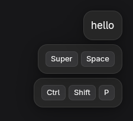

# Saiki



Saiki shows your keystrokes in a click-through overlay for demos and screen recordings on Wayland. Rounded charcoal cards stack newest first along either screen edge and begin fading 2.6 seconds after the last key. Saiki renders them with [GPUI](https://gpui.rs/). The card style and motion take cues from [Hokum’s notifications](https://github.com/anomalyco/hokum).

The build pins a [published snapshot of Zed’s GPUI](https://github.com/gpui-archipelago/gpui-unofficial) for its Wayland layer-shell and click-through APIs.

## Install on Arch Linux

Download the x86_64 package from [GitHub Releases](https://github.com/pruven/saiki/releases/latest) and install it with `sudo pacman -U ./saiki-*-x86_64.pkg.tar.zst` from the download directory. Open Saiki from your launcher or run `saiki`.

## Run from source

```sh
bin/build
build/saiki
```

Click **Start capture**, then close the controls or switch apps. Saiki stays in the tray and continues showing keys. Use the tray menu to open Saiki, start or pause capture, or quit. Launching Saiki again opens the current session, and `saiki --quit` exits it from the command line.

Enable **Only show Ctrl, Alt or Super shortcuts** to hide ordinary typing. Pausing clears the cards. To include the overlay in a recording, capture an entire monitor.

Letters appear together as you type. Space finishes a word, Backspace edits the current word, and shortcuts get their own cards.

Use **Overlay position** to pick a corner or the center of the top or bottom edge. Saiki remembers the position between launches.

Click **Preview** or run `build/saiki --demo` to show a sample stack.

| In the Saiki window | Action |
| --- | --- |
| Space | Start or pause capture |
| P | Open the position picker. Use arrows and Enter to select |
| Q | Quit |
| ? | Show shortcuts |

Capture starts paused and uses read-only access to the session’s keyboard devices. Cards stay in memory. Pause capture before typing sensitive text. Saiki pauses on lock events and desktop inactivity reported by logind.

## Requirements

- A Wayland compositor with `zwlr_layer_shell_v1`, such as Hyprland, Sway, or niri.
- A D-Bus session bus and a StatusNotifier-compatible tray for the tray icon.
- Read access to the session keyboard’s `/dev/input/event*` device. Saiki reports missing access in its window.
- A Vulkan driver, libinput, xkbcommon, and system fonts. On Arch, see [PKGBUILD](pkgbuild/PKGBUILD) for package names.

Saiki reads Hyprland’s main keyboard layout and active group when you start capture. On other compositors it uses xkbcommon’s defaults. Set `XKB_DEFAULT_LAYOUT`, `XKB_DEFAULT_VARIANT`, or `XKB_DEFAULT_OPTIONS` when launching Saiki to choose a layout explicitly. It shows physical keypresses and modifier chords. Text committed by IMEs and compose sequences is outside the overlay’s scope.

## Package and test

Run `bin/install` to build and install the Arch package and launcher entry. Run `makepkg -f` inside `pkgbuild/` to build the package archive.

Run `bin/test` for keyboard layout, modifier, and stack ordering tests. Use `SAIKI_TEST_DEVICES=1 bin/test` from an active desktop session to test keyboard-device access.

To publish a release, match the versions in `Cargo.toml` and `pkgbuild/PKGBUILD`, update `Cargo.lock`, and push the matching `vX.Y.Z` tag. GitHub Actions tests the code and publishes the x86_64 Arch package with a SHA-256 checksum. Running the workflow manually builds a downloadable artifact.
